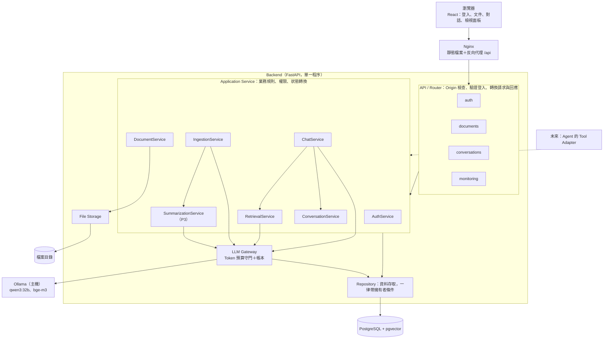

# 02 系統架構

狀態：已確認（2026-11-05，決策日誌 D46）。P1 完成後凍結；之後只在實作或測試發現實際問題時修改，並記入決策日誌。
內文中的〔使用者決定〕標示該項由使用者選定，並附決策日誌的編號。

## 1. 實驗依據（2026-11-05，本機實測）

| 項目 | 結果 |
|---|---|
| 論文全文長度 | 14,443 tokens（`qwen3:32b` 計數），超過 10K |
| Ollama 是否提供 tokenize 端點 | 否（`/api/tokenize`、`/v1/tokenize` 皆 404） |
| prompt 超過 `num_ctx=10000` | 不報錯，默默截斷為 10,000 tokens |
| 對話樣板的固定開銷 | 約 17–29 tokens |
| thinking 的代價 | 同一題：關閉時輸出 32 tokens／1.5 秒；開啟時 328 tokens／13.2 秒 |
| 生成速度 | 約 26 tokens／秒 |
| 每 token 的字元數 | 英文內文 5.5、數字表格 2.4、中文 1.5 |
| `bge-m3` 向量 | 1024 維，已正規化 |
| 嵌入速度 | 單筆 334 ms；30 段一批 1.39 秒 |
| 跨語言檢索 | 中文問題能找到正確的英文段落（相似度 0.53–0.66） |
| 無關問題的最高相似度 | 0.33 |

限制：檢索的數字來自一份文件、四個問題、每段 2,000 字元的粗切，只能當方向參考，正式數值由 P4 實驗決定。

## 2. 系統架構

### 2.1 架構圖



### 2.2 分層規則

- **Router** 不直接操作資料庫，只做：Origin 檢查、確認登入、把請求轉成 Service 的輸入、把結果轉成回應。
- **Application Service** 放業務規則、權限判斷與狀態轉換。每個方法都明確接收操作者（目前登入的使用者），有清楚的輸入與輸出。
- **Repository** 只負責資料存取。每個查詢都要求傳入擁有者；切塊檢索以 join `documents` 並比對 `owner_id` 過濾。
- **LLM Gateway** 是呼叫 Ollama 的唯一入口。預算檢查與帳本寫入在 Gateway 內完成，無法繞過。Embedding 也經由 Gateway 呼叫，但它不是生成，不計入 10K。
- 不建立通用的 Repository 基底類別，也不為每個類別建介面。只有 LLM、Embedding、Tokenizer 三個外部相依保留介面，供單元測試替換。Repository 直接對真實的 PostgreSQL 測試。

### 2.3 模組與 Service

資料夾依功能模組，用到才建立：

```
app/backend/app/
├── main.py
├── core/             環境變數載入、資料庫連線、錯誤格式、密碼與 Session、Origin 檢查
├── models.py         所有資料表
├── auth/             router、service
├── documents/        router、service、repository、storage
├── ingestion/        service、parsers、chunker
├── retrieval/        service
├── conversations/    router、service、repository
├── chat/             service（問答流程）
├── summarization/    service（P3）
├── llm/              gateway、tokenizer
└── monitoring/       router（健康檢查、帳本）
```

| Service | 責任 | 主要輸入 → 輸出 |
|---|---|---|
| AuthService | 註冊、登入、登出、取得目前使用者、更新個人資料 | 帳密 → 使用者與 Session |
| DocumentService | 上傳、清單、讀取、刪除、重試；文件狀態轉換 | 操作者＋檔案或文件 id → 文件 |
| IngestionService | 執行處理工作；進度、失敗處理、寫入前確認、啟動時的復原 | 工作 id → 切塊與狀態 |
| RetrievalService | 問題嵌入、在擁有者與選取範圍內檢索、相似度門檻、依預算裝填 | 操作者＋問題＋文件範圍 → 證據清單 |
| ConversationService | 對話的新增、清單、讀取、刪除；訊息的寫入與狀態 | 操作者＋對話 id → 對話與訊息 |
| ChatService | 問答流程（第 8 節） | 操作者＋對話＋問題 → 串流事件 |
| SummarizationService | 章節辨識、章節摘要、全文摘要、數字來源核對 | 文件 → 摘要 |
| LLM Gateway | 計數、預算檢查、呼叫 Ollama、寫帳本 | prompt → 文字或串流 |

### 2.4 登入與 Session 安全

決策日誌 D44。採用伺服器端 Session 加 HttpOnly Cookie。

**密碼**

- 以成熟的函式庫做 Argon2 雜湊，不自行設計雜湊或加密。具體套件在 P2-A 動手前確認並釘版本。
- 帳號不存在與密碼錯誤回傳相同的錯誤，不透露是哪一個。

**Session**

- Session token 由伺服器以密碼學安全的亂數產生（32 位元組）。資料庫只存它的 SHA-256，不存 token 本身。
- Cookie 屬性：`HttpOnly`、`SameSite=Lax`、`Path=/`；`Secure` 由 `SESSION_COOKIE_SECURE` 控制（本地 HTTP 為關閉，經 HTTPS 提供服務時必須開啟）。
- 有效期由 `SESSION_TTL_HOURS` 設定；過期的 Session 驗證失敗並被刪除。

**避免 Session Fixation**

- 伺服器不接受任何由用戶端指定的 Session 值。
- 每次登入成功都發出全新的 token。請求中若帶著既有的 Session，先把它刪除再發新的。
- 登出時刪除伺服器端的 Session 紀錄並清除 Cookie。
- 驗收：AC-45。

**CSRF 防護**

不只依賴 `SameSite` 與 JSON 請求。採用以下幾層：

1. `SameSite=Lax`：跨站的 POST 不會帶 Cookie。
2. **Origin 驗證**：所有會改變資料的請求（POST、PATCH、DELETE，包含註冊、登入、登出）都檢查 `Origin` 標頭，必須在 `ALLOWED_ORIGINS` 清單內。沒有 `Origin` 時改看 `Referer` 的來源；兩者都沒有或不在清單內，回 `403`，在驗證登入之前就擋下。
3. GET 不改變任何資料（AC-27），所以跨站的 GET 無法造成變更。

這是以標準標頭驗證來源的做法，沒有另外使用 CSRF Token。它依賴瀏覽器在跨來源的寫入請求中送出 `Origin`，而現行瀏覽器都會送。非瀏覽器的用戶端（測試、curl）必須自行帶上允許的 `Origin`。驗收：AC-44。

**已知不足**（列入第 11 節）：沒有登入次數限制；本地執行未使用 HTTPS。

### 2.5 未來 Agent 的擴充位置

- Agent 不直接碰資料庫或 Repository，只透過 Tool Adapter 呼叫 Application Service，並帶入代表使用者的操作者身分。權限、狀態規則、Token 預算與帳本因此自動適用。
- 現在只遵守一條規則：Service 的方法明確接收操作者。不建立 Tool Adapter，不引入 LangGraph、CrewAI 等框架。
- 會修改或刪除資料的操作，未來由 Agent 呼叫時需要使用者明確授權，留到實作 Agent 時設計。

## 3. 入庫流程與背景工作

### 3.1 文件與處理工作分開

- **Document** 是持久存在的文件物件。
- **IngestionJob** 是一次處理工作，分兩類：
  - `index`：解析、切塊、嵌入。成功後文件狀態變 `ready`，可以搜尋與問答。
  - `summary`：章節摘要與全文摘要（P3）。`index` 成功後自動排入。成功後摘要狀態變 `ready`。
- 工作的狀態只有 `queued`、`running`、`completed`、`failed`。不設 `cancelled`〔使用者決定，D45〕：刪除文件時工作紀錄一併刪除，進行中的工作以 3.4 的方式失效。
- 摘要狀態與文件狀態分開：摘要還在做或失敗時，文件仍可進行一般問答（AC-42）。
- 工作在後端程序內以非同步工作執行，不使用 Celery、Redis 或另外的 Worker。已知限制：同一時間只適合少量文件入庫；後端重啟會中斷進行中的工作（3.6）。

### 3.2 上傳與建索引的步驟

1. **接收**：通過 Origin 檢查與登入驗證；檢查副檔名與大小；計算內容雜湊。同一使用者已有相同內容的文件時，直接回傳既有文件。
2. **建立**：把檔案存到儲存目錄；在同一個資料庫交易內建立文件（`uploaded`）與一筆 `index` 工作（`queued`）。交易失敗時刪除剛存的檔案。
3. **解析**（本地程式庫，不經 LLM）：PDF 用 pypdf（預設模式）逐頁取文字並保留頁碼〔使用者決定，依 `evaluation/pdf-parser-comparison/` 的實驗；決策紀錄 ADR 0005、決策日誌 D54〕；TXT 與 Markdown 整份文字、頁碼記為 1。解析不出文字則工作失敗。
4. **切塊**：見第 5 節。
5. **嵌入**：分批送 `bge-m3`。
6. **寫入**：見 3.3。
7. 進度以 SSE 提供；同時記錄在工作紀錄上，重新整理頁面後仍可取得目前進度。

### 3.3 交易與失敗時的復原

- 一次 `index` 工作的所有切塊、文件的頁數與「文件變 `ready`、工作變 `completed`」在**同一個資料庫交易**內寫入。任何一步失敗就整批復原，不留下半成品切塊。
- 失敗時，另開一個交易把工作標為 `failed`、文件標為 `failed` 並記錄原因。
- `summary` 工作同理：所有摘要與「摘要狀態變 `ready`」在同一個交易內寫入。
- 驗收：AC-36。

### 3.4 刪除文件與進行中的工作

要保證：文件被刪除後，尚未完成的工作不會再寫入任何切塊或摘要。

- **寫入前確認**：背景工作每次要寫入切塊或摘要時，在同一個交易內先鎖定並讀取自己的工作紀錄。紀錄不存在（文件已刪除，工作隨之刪除），或狀態不是 `running`，就立刻放棄，不寫入任何資料。
- **鎖定的順序**（實作時補充，2026-11-05）：先鎖定文件、再鎖定工作紀錄。刪除文件也是先鎖文件、再經由連帶刪除鎖工作，兩邊順序相同。只鎖工作紀錄是不夠的：寫入切塊時資料庫會為了外鍵去鎖文件，若與刪除的順序相反，兩個交易會互相等待而死結。
- **為什麼這樣就夠**：刪除文件的交易會刪除工作紀錄，兩邊鎖的是同一筆紀錄，所以只會有兩種結果：
  - 寫入先完成，隨後的刪除把這些資料一併清掉。
  - 刪除先完成，寫入時發現工作不存在而放棄。
- **第二道保險**：切塊與摘要的外鍵指向文件。文件不存在時，資料庫本身會拒絕寫入。
- **階段之間也確認一次**：每進入下一個階段前檢查工作是否仍然有效，避免繼續做白工。
- **盡快停止**：刪除時通知同一程序內正在執行的工作停止。這只是為了不繼續佔用 Ollama，正確性不依賴它。進行中的 LLM 呼叫若因此被取消，帳本記為 `interrupted`，實測值未知。
- 原始檔案在資料庫交易成功後才刪除。
- 驗收：AC-38、AC-46。

### 3.5 重試

- 只有失敗的處理可以重試：文件 `failed` 時重試 `index`；文件 `ready` 而摘要 `failed` 時重試 `summary`。
- 每次重試新增一筆工作，重試次數加一；舊的工作紀錄保留，可看出處理歷史。
- 重試 `index` 時，在寫入的同一個交易內先清除該文件既有的切塊，所以不會有重複的切塊。
- 同一文件同一類工作，同時最多一筆在排隊或執行中；否則回 `409`。
- 驗收：AC-37。

### 3.6 服務重啟後的復原

不自動續跑。後端啟動時：

- `queued`／`running` 的工作標為 `failed`，原因記為服務重啟；對應的文件狀態或摘要狀態標為 `failed`。使用者可以重試。
- `pending`／`streaming` 的助理訊息標為 `interrupted`。
- `pending` 的 LLM 呼叫標為 `failed`，實測值未知。
- 驗收：AC-39。

選擇「標為失敗、由使用者重試」是因為行為確定、容易測試，而且沒有另外的工作佇列服務。

### 3.7 P2 前期的最小流程驗證

不等到 P2-D 才第一次整合。P2-A 就以一支驗證腳本跑通最小流程：以 `bge-m3` 嵌入數段文字 → 寫入 pgvector → 以相似度取回 → 交給 `qwen3:32b` 產生回答，並印出 Ollama 回報的 token 數（AC-47）。

目的是提早確認 Ollama、Embedding、pgvector 三者在本專案的資料庫與設定下能串起來。腳本不屬於正式的應用程式碼。

## 4. Token 預算
### 4.1 計數方式

需要在送出前就知道 prompt 有幾個 token，但 Ollama 沒有 tokenize 端點，而且字元數換算不可靠（表格與英文內文相差 2.3 倍）。

| 選項 | 做法 | 優點 | 缺點 |
|---|---|---|---|
| A | 用 `tokenizers` 程式庫載入 Qwen3 的 tokenizer 檔，在本地精確計數 | 精確、快、離線可用 | 多一個相依與一個約 11MB 的 tokenizer 檔；尚未實測與 Ollama 的計數是否一致 |
| B | 請 Ollama 代算（送出後讀 `prompt_eval_count`） | 不加相依、與實際計數必然一致 | 每算一次就是一次模型呼叫，切塊時要算很多次 |
| C | 依字元類別用保守係數估算 | 不加相依 | 為了安全要高估，浪費大量預算 |

**〔使用者決定：選項 A〕** 決策日誌 D33。

- P2 用 Hugging Face `tokenizers` 載入與 Ollama 的 Qwen3 模型相對應的 tokenizer，計算切塊、對話歷史與最終 prompt 的 token 數。
- 以 Ollama 回傳的 `prompt_eval_count` 驗證本地計數，測試情境：中文、英文、中英混合、程式碼、多輪對話，確認 tokenizer 與 chat template 一致（驗收條件 AC-25）。
- 發現誤差時，優先修正 tokenizer 或 template 的設定；必要時加入安全緩衝，避免實際輸入超過預算。
- P4 再依測試結果調整。

**誤差的驗收方式（AC-25）**

低估比高估危險：低估會讓實際輸入超過 10K 而被 Ollama 默默截斷，高估只是浪費一點預算。所以兩個方向分開判定。

- 比對對象：本地計數算的是「套用 chat template 之後、實際送出的完整 prompt」，與 Ollama 回報的 `prompt_eval_count` 比。
- 測試矩陣：五種情境（中文、英文、中英混合、程式碼、多輪對話）× 三種長度（約 200、約 2,000、約 8,000 tokens），共 15 筆。
- **低估零容忍**：每一筆都必須滿足「本地計數＋安全緩衝 ≥ 實測值」。安全緩衝的起始值為 0；若修正 tokenizer 與 template 後仍有低估，緩衝設為觀察到的最大低估量的 2 倍（至少 16 tokens），並寫入決策紀錄。
- **高估上限**：本地計數＋安全緩衝 − 實測值，不得超過 32 tokens 與實測值 2% 兩者中較大者。
- **執行期持續檢查**：每次真實呼叫後，若實測的 prompt tokens 大於送出前的預估值，在帳本標記為低估事件；出現任何低估事件即視為 AC-25 不通過，需回頭調整緩衝。

**實測結果與緩衝的設定（2026-11-05，Ollama 0.24.0）**〔使用者決定，D56；ADR 0006〕

- 內附的 tokenizer 與 Ollama 模型內嵌的詞表（151,669 筆）、合併規則（151,387 條）逐筆相同；chat template 的對照實作在 18 筆探測中與 Ollama 完全一致。
- AC-25 的 15 筆：11 筆完全相同；4 筆約 8,000 tokens 的案例本地少 1–2 個 token。
- 原因：同一個字元連續出現三次以上時，Ollama 合併 token 的順序與參考實作不同，會切出較多 token。詞表、規則與模板都相同，無法靠修正設定解決。
- 依上面的規則，`TOKEN_SAFETY_BUFFER` 設為 **16**（最大低估量 2 的 2 倍小於下限 16）。
- **這個緩衝不是絕對保證。** 低估量會隨內容成長：40 個連續的 `.` 本地算 2、Ollama 算 8；目錄的點線 100 行本地 1,080、Ollama 1,280。本地計數負責送出前的預算分配（包含預留給回答的 token）；真正防止 context 超量的是 Ollama 端的限制（4.2 的第 3 層）。
- 不採用的做法：對含重複字元的片段改用保守計數（會高估、浪費額度）；照抄 Ollama 的演算法（綁死在特定版本的內部實作）；另外架設 tokenizer 服務。

### 4.2 四層防線

1. **組裝前**（本地計數）：依預算把證據裝進 prompt，裝不下的不放，不做截斷。
2. **送出前**（本地計數）：整個 prompt 的 token 數＋安全緩衝＋這次呼叫的輸出上限，超過 10,000 就拋出錯誤、不送出。
3. **伺服器端**（Ollama 強制）：每個請求都要求 Ollama 不截斷輸入、不捨棄已有的內容。本地計數若低估到實際超量，Ollama 會拒絕請求或提早停止輸出，不會悄悄截斷。
4. **回應後**（帳本）：把 Ollama 回報的實測值與停止原因寫入帳本，與送出前的預估值並列。

第 1、2 層負責規劃：決定放幾段證據、留多少給回答。第 3 層負責保證：Ollama 的預設行為是超量時不報錯，把輸入截短或把前面的內容擠掉，所以必須明確關閉。兩者的驗收分開：本地計數的準確度是 AC-25，伺服器端的防護是 AC-55、AC-56。

**每個生成請求必帶的參數（AC-54）**〔使用者決定，D56〕

| 參數 | 位置 | 值 | 作用 |
|---|---|---|---|
| `num_ctx` | `options` 之下 | `LLM_CONTEXT_LIMIT`（10,000） | context 的大小，prompt 與回答合計 |
| `num_predict` | `options` 之下 | 這次呼叫的輸出上限（問答 2,500、摘要 1,500）；必須大於 0 且小於 context 上限 | 回答最多使用的 token |
| `truncate` | 請求的最上層 | `false` | 輸入放不下時回 HTTP 400，不截短 |
| `shift` | 請求的最上層 | `false` | context 用盡時停止輸出，不捨棄前面的內容 |

- 位置不能放錯：`truncate` 與 `shift` 放在 `options` 之下會被 Ollama 忽略。
- 請求只在 `app/llm/ollama_api.py` 一處組裝；有測試檢查其他程式（含驗證腳本）不得自行組裝，所以不會只有部分呼叫套用。
- 以上行為在 Ollama 0.24.0 實測。**升級 Ollama 之後必須重跑標記為 `llm` 的測試**，確認行為沒有改變。

**回答如何結束（AC-56、AC-57）**

Ollama 正常結束串流不代表回答已完整生成。以最後一筆回應的 `done_reason` 與輸出的 token 數判定（串流與非串流的結果相同）：

| 情況 | Ollama 的回應 | 判定 | 回答是否完整 |
|---|---|---|---|
| 自然結束 | `done_reason: stop` | `stop` | 是 |
| 達到輸出上限 | `done_reason: length`，輸出數等於 `num_predict` | `output_limit` | 否 |
| context 用盡 | `done_reason: length`，輸出數小於 `num_predict`（此時 prompt＋輸出等於 `num_ctx`） | `context_exhausted` | 否 |
| 輸入超量 | HTTP 400，在產生任何內容之前 | 呼叫失敗 | 沒有回答 |
| 其他或缺少 `done_reason` | — | `unknown` | 否 |

- **只有 `stop` 的回答可以標為 `completed`。** 其餘情況，助理訊息標為 `interrupted`，保留已產生的內容，介面標示回答未完成。不新增狀態〔使用者決定，D57〕。
- **中斷的原因要能區分**〔使用者決定，D57〕：`interrupted` 涵蓋數種情況，原因記在該次呼叫的 `finish_reason`：`output_limit`（達到輸出上限）、`context_exhausted`（context 用盡）、`client_disconnect`（串流途中使用者離開或連線中斷）、`unknown`（Ollama 正常結束但原因無法判定）。前兩者由 `done_reason` 與輸出的 token 數判定，`client_disconnect` 由後端自己偵測到連線中斷時記錄。
- 摘要工作收到不完整的輸出時視為失敗，不存入不完整的摘要。

**帳本如何處理失敗與中斷（AC-08）**

帳本的一筆紀錄在「送出前」就先寫入，之後再更新，所以失敗的呼叫也會留下紀錄。

| 狀態 | 何時 | 預估值 | 實測值 |
|---|---|---|---|
| `pending` | 通過預算檢查、即將送出 | 有：預估 prompt tokens、輸出上限 | 無 |
| `completed` | 正常結束 | 保留 | 有：Ollama 回報的 prompt 與 completion tokens |
| `failed` | 連線失敗、逾時、Ollama 回傳錯誤 | 保留 | 留空表示未知；記錄錯誤訊息 |
| `interrupted` | 串流途中使用者離開或連線中斷 | 保留 | 通常拿不到，留空表示未知；另記已收到文字的本地計數，標示為預估 |

- 被第 2 層擋下、根本沒有送出的請求不算一次 LLM 呼叫，不寫入帳本，只記錄在應用程式日誌並回報錯誤。
- **被 Ollama 拒絕的輸入**（第 3 層）是一次已送出的呼叫：帳本記為 `failed`，錯誤註明輸入超過 context，實測值留空表示未知；同時記為一次低估事件，因為本地計數認為放得下。
- **停止原因**：正常結束的呼叫記錄停止原因。因輸出上限或 context 用盡而停止的呼叫，本身仍是 `completed` 且有實測值，但回答不完整，處理方式見上面的「回答如何結束」。
- **實測值未知時要明確標示**：`failed` 或 `interrupted` 的呼叫若拿不到 Ollama 回報的 token 數，實測欄位留空，表示未知。不以預估值填入實測欄位。
- **預算上界**：每筆紀錄都保存送出前通過檢查的上界，即「預估 prompt＋輸出上限」。第 2 層保證它 ≤ 10,000。
- **合規報告分開列出兩類**，不混在一起：
  - 有實測值的呼叫：數量，以及其中最大的實測總和。這才是**實測合規**的依據。
  - 沒有實測值的呼叫：數量，以及其中最大的預算上界。這只能說明它們**送出前通過了預算檢查**，報告與介面上不得稱為實測合規。
- 串流中斷時，另外記錄以本地 tokenizer 對已收到文字的計數，標示為預估，只供參考。

### 4.3 預算配置（問答）

| 區塊 | 上限（tokens） |
|---|---|
| 系統指示與輸出格式 | 500 |
| 對話記憶 | 800 |
| 使用者問題（`QUESTION_TOKEN_BUDGET`，可設定） | 200 |
| 檢索到的證據 | 5,500 |
| 輸出保留（`num_predict`） | 2,500 |
| 安全邊際（含樣板開銷） | 500 |
| 合計 | 10,000 |

固定 Top-K 之下，證據實際用量為 K × 切塊大小（例：5 × 400 = 2,000），低於上限。P4 要實驗的 K = 3、5、8 與切塊 256、400、600 的所有組合都不超過 5,500 的上限（最大 8 × 600 = 4,800）。

**問題的預算**〔使用者決定，D45〕：問題超過 `QUESTION_TOKEN_BUDGET`（預設 200 tokens）時，P2 回覆請使用者縮短，不送給 LLM，也不截斷問題。這個值是可設定的參數，未來可以改成依其他區塊的實際用量動態分配。P3 改寫後的問題同樣受這個上限約束。

### 4.4 Thinking

**〔使用者決定：預設關閉，P4 再比較〕** 決策日誌 D34。實測開啟後輸出 token 約為 10 倍，會壓縮可用的證據空間並拖慢回應。

## 5. 切塊
- 以 token 數計長度，固定大小、相鄰兩塊重疊。
- PDF 逐頁處理，每塊記錄所屬頁碼；跨頁的內容不合併，以保證引用的頁碼正確。
- 每塊記錄：文件、頁碼、塊序、token 數、文字。
- **起始數值〔使用者決定〕**：每塊 400 tokens、重疊 80 tokens（20%）。決策日誌 D30。
  - 400 tokens：在內容完整性與檢索精確度之間取得初步平衡。
  - 重疊 80：降低跨段落資訊被切斷的風險。
  - 這是工程預設值，尚未證明是最佳設定；P4 比較 256／400／600。
- 已知代價：會從句子中間切開；相鄰切塊的重疊讓被切開的句子在其中一塊是完整的。
- **表格區域獨立成塊（P3，2026-11-06，ADR 0007）**：固定長度切塊會把表格切開。P2-C 的實測（`evaluation/table2-chunking/fixed-size-400-80.table2-rows.json`）：Table 2 落在第 8 頁的三個切塊中，16 列都至少完整出現一次，但只有 14 列與自己的區塊標題同塊、6 列與資料集標題同塊。架構原列三個候選做法（相鄰切塊一起送出、表格區域獨立成塊、逐列改寫），P3 依量測採用第二個，並加上第三個的通用形式：`app/ingestion/tables.py` 依形狀辨識表格區域（`Table N:` 標題行、表頭行、數字列，到第一行內文為止；沒有數字列的不算），該區域成為一塊，每一列依表頭推出的結構逐格改寫並附欄位標籤（「指標 — 分組: 子欄 數值, …」），上限是切塊大小的 4 倍，超過時依列切開並重複標題與表頭。只保留整塊時切塊量測已三項 16/16，但真實模型仍把 `NaiveRAG -High` 的區塊讀錯歸屬，逐格改寫後才讀對。Table 2 改寫後為一塊 1,485 tokens，其餘切塊仍在 400 以內。比較、數據與未採用的理由見 ADR 0007。**D64（2026-11-06，試過、未採用）**：真實模型仍會把同欄位、相鄰指標列的數字張冠李戴。試過改為每個欄位分組一行（「指標 — 資料集: 子欄 數值, 子欄 數值」，Table 2 成為 64 行、1,653 tokens，上限需提高到 5 倍），但三次重測錯誤數 3／1／3 對原本的 1／1／1，相似度 0.711 → 0.641，沒有改善，退回一行一指標。改以回答後的規則式數字標籤核對處理（第 6 節 AC-26 的擴充）。文獻依據與重測結果見 ADR 0007 與決策日誌 D64。
- **Table 2 那一題（AC-14）必須在 P3 通過〔使用者決定〕**，決策日誌 D37。最終判定以真實模型的 Q3 回答對照 `evaluation/ground-truth/key-facts.md` 為準。

## 6. 檢索
- 問題經 `bge-m3` 嵌入後，在搜尋範圍內取 cosine 相似度最高的 K 段。
- **多區塊表格以區塊向量計分（P4，D82，使用者提出）**：一塊裝了幾組比較的表格（如多個 baseline 各一區塊），整塊向量是它們的平均，問題只問其中一組時排名偏低（量測：整塊 0.582、只留被問的區塊 0.669、第 1 名段落 0.622）。入庫時把這種表格依區塊表頭切段、每段各算一個向量存入 `chunk_vectors`；檢索時一個 chunk 的距離取自身向量與各區塊向量的最小值，回傳仍是整塊 chunk。散文 chunk 沒有區塊向量，行為不變。區塊靠表格自己的結構（重複出現的表頭行）切，不比對任何名稱。
- **表格的討論段隨表格一起進入證據（Table-aware Context Expansion，P3，D62）**：Top-K 的結果含表格塊時，依文件順序往後看最多兩塊：以標題開頭的塊（下一節）、另一個表格、已在 Top-K 的塊都不納入；塊內出現標題（章節在這塊內結束）則納入後停止。純依文件結構與位置判斷，不呼叫 LLM，不針對任何文件寫規則。補進來的塊排在檢索結果之後、同樣受證據預算約束，來源標 `origin=table_context` 且 `score` 為 `null`，與 `origin=retrieval` 的 Top-K 分開，P4 比較 Top-K 時以後者為準。依據：Table 2 的討論段對第三題的相似度排第 8，K＝5 拿不到，模型因此概括出事實性錯誤；加入後定義與結論正確（`docs/04-dev-journal/P3.md`）。
- **資料隔離**：檢索永遠只在操作者自己的文件內進行。查詢以 join `documents` 並比對 `owner_id` 過濾，不依賴呼叫端傳入的文件清單是否正確。
- **搜尋範圍**：
  - 請求中指定了文件：只搜尋那些文件。不存在或不屬於自己回 `404`；存在但尚未 `ready` 回 `409`。
  - 沒有指定：搜尋自己所有 `ready` 的文件〔使用者決定，D45〕。前端必須明確顯示搜尋範圍為「所有可用文件」。多份文件仍共用 Top-K = 5。
  - 處理中或失敗的文件一律不在範圍內。
  - 自己沒有任何 `ready` 的文件時回 `409`，不呼叫 LLM。
- 多文件時，K 是跨所有選取文件的總數，不為每份文件保留名額。已知代價：跨文件的比較題可能只取到其中一份的片段，列入 P4 題庫檢驗；「每份文件保底名額」是 P4 的選做對照實驗（第 9.6 節）。
- **起始值 K = 5〔使用者決定〕**：控制每次提供給 LLM 的證據數量，避免過多無關資訊。P4 比較 K = 3／5／8，評估項目為回答正確性、證據涵蓋率、token 使用量、回應時間。決策日誌 D30。
- 檢索結果依相似度排序後交給生成；每段附上文件名稱與頁碼，供回答引用。

### 找不到答案時
固定 Top-K 永遠會回傳 K 段，即使都不相關，所以要另外兩道機制（決策日誌 D31）：

1. **相似度門檻**：第一名的相似度低於門檻，直接回覆找不到相關內容，不呼叫生成。
2. **LLM 判斷**：通過門檻的，指示 LLM 只依證據作答，證據不足要明說；回答中沒有任何來源標註時，視為找不到答案。

門檻的起始值 0.45〔使用者決定：暫定 0.45，P4 依實驗校正〕，決策日誌 D36。依據是相關問題約 0.53–0.66、無關問題 0.33，取中間；樣本只有四題。風險：定太高會誤拒答。

## 7. 摘要
1. **分章節**：
   - Markdown：依標題行。
   - PDF：辨識章節標題。論文的標題是 small-caps，抽出後會變成 `I NTRODUCTION` 這種被拆開的字，需要先合併還原。
   - **不假設解析後的標題是正確的**〔使用者決定，D54〕：實測 pypdf 抽出的 22 個標題，文字全部被拆開；只靠規則合併可還原 15 個，其餘 7 個（如 `LIGHT RAG`、`LLM S`）無法由規則判斷。章節摘要實作之前，先有標題辨識與正規化的測試（AC-53）。章節的邊界以編號與所在頁判定，不依賴標題文字是否完整。
   - 辨識不出章節的文件（如純文字）：退回依固定 token 批次分段。
2. **章節摘要**：每個章節各摘要一次。章節超過單次可容納的輸入量（約 6,000 tokens）時，先分段摘要再合併。
3. **全文摘要**：把所有章節摘要合併成一份；章節摘要的總量仍超過輸入量時，分組再合併一層。
4. 章節摘要與全文摘要都存入資料庫。提問時若判定為摘要類問題，直接以存好的摘要作為證據來回答。

**摘要的來源追溯（AC-26）**〔依使用者審閱意見〕

- 每份章節摘要都記錄：所屬文件、章節標題、涵蓋的頁碼範圍、以及它是由哪些原文切塊產生的。全文摘要記錄它是由哪些章節摘要合併的。
- 摘要類回答的來源，標示文件名稱、章節標題與頁碼範圍。
- **涉及具體數字時要能追溯原文**：
  - 產生章節摘要時，指示 LLM 在每個具體數字後標註它所在的頁碼。
  - **比較結論的範圍依來源（D63、D66，2026-11-06）**：產生章節摘要、全文摘要與摘要類回答的提示詞，都要求比較結論保留來源給它的範圍：有結果不符整體趨勢時要保留或明說，沒有逐一證據不寫「所有情況下」「全面優於」。這條規則原本只放在檢索回答的提示詞（D63）；三題評測發現全文摘要寫出「在所有資料集與評估面向上都領先」，摘要回答照抄，才補到摘要的三處（D66）。通用原則，不含任何特定論文的字面。
  - 回答完成後，程式檢查回答中的數字是否出現在所引用頁面的原文中。找得到的，來源附上該頁原文片段；找不到的，在回答後標示「此數字未能在原文中核對」，不靜默放行。
  - **回答自算的差距核對（D96，2026-11-08）**：回答裡「x% vs y%（+a pp, +b% relative）」「a percentage point gap」這類由兩個表格數字推出的差距，程式用同一句的兩個數字重算：百分點為 |x−y|，相對增幅以較小值或較大值為基準擇一符合即可；不符的列入 `done.arithmetic_issues`（status inconsistent，detail 寫正確值）並在回答後以註記標出「回答自行計算、與其數字不符的差距」；符合的差距不再列為「無法核對」。沿用 D76 的倍數核對，不呼叫 LLM。
  - **比較事實塊附上該對的全部格子（D96）**：事實塊除每對的計數與例外外，另列「Figures (A vs B): 條件: A x% vs B y%; …」一行，涵蓋該對的每個條件，讓模型舉例時從這裡抄、不必回讀原始表格那一列裡同名方法的多個數字（配對錯的來源）；預算從 800 提到 1,400 tokens，不夠時先捨去這一行、再捨整對。
  - **數字的標籤核對（D64，2026-11-06；D67 改為結構化宣稱比對）**：數字找得到不代表掛對了名字。來自表格切塊的數字在原文中是一個格子：列、欄位分組、子欄三類標籤（第 5 節的逐格改寫格式），同一組只有兩格時另有比較對象（另一格）。回答完成後，程式把答案中含該數字的句子讀成宣稱：每類標籤依角色取（寫在數字旁的是它自己的；否則子句、整句唯一提及的；「the same …」可繼承上一句），緊接在 over／against／compared to 等之後的方法名是比較對象而非所屬方法；不以距離最近的名稱判定。**同一句兩個各自帶方法名的數字（「A x% vs B y%」「A scores x%, while B scores y%」）且條件標籤相同時，互為比較對象（D96）**：表格若把 A、B 直接配對，x 必須是 A 在「對 B」那一格的數字——「LightRAG 67.6% vs GraphRAG 45.6%」拿的是對 NaiveRAG 那格的 67.6%，列為標籤不符；表格只透過共同基準間接比較的（LightRAG 對 -High）不受此限。三種結果：沒有任何格子符合 → 列入 `done.mislabelled_numbers` 並在回答後標示；全部標籤都給了且有格子符合 → 支持、不列出；標籤不足或同類有兩個候選 → `done.unresolved_numbers`，不當成錯誤。規則比對、不呼叫 LLM；核對不知道不等於答案錯，沒列出也不等於答案全對（D67 的兩個真實案例：對照方被當成所屬方的誤報、句中沒寫資料集的漏報）。適用於所有依第 5 節格式改寫的表格，不含任何特定論文的字面。
  - **全稱比較宣稱的核對（D68，2026-11-06）**：回答中「某方法在所有情況下優於／劣於其他方法」的句子，對引用頁面的表格逐格比：主詞與比較對象共享（列、分組）的格子裡，主詞較高與較低的格數兩邊都有，則不論指標方向這句都不成立 → `done.overstated_claims`（附少數方向的格子為反例）並在回答後標示；全部同一方向不報（不假設高好或低好）；沒有共享格子標無法判定。帶 most／nearly 等限定詞不算全稱。
  - **引用支持的懷疑（D68，2026-11-06）**：每句有引用的陳述，以內容詞覆蓋率比較被引來源與其他給模型的來源；被引來源幾乎不含這句的內容詞（含數字）、而另一頁的來源含大半時列入 `done.doubtful_citations`；被引來源含這句的數字、或較接近的來源與被引來源同頁，都不算可疑。只標懷疑、不判正確、不附說明；純字面、不呼叫 LLM。

參考文獻章節不納入摘要。

**多文件時問摘要〔使用者決定：每份各給一段摘要〕**：只選一份文件時摘要那一份；選多份時，每份各給一段摘要並標明檔名，不把不同文件的內容混在一起。決策日誌 D32。

每一次摘要呼叫都走第 4 節的預算守門：輸入約 6,000、指示約 500、輸出約 1,500、其餘為邊際。

以論文估算：約 9 個主要章節，摘要階段約 10–12 次呼叫，每次輸出數百 tokens，合計約 2–4 分鐘。這是估算，尚未實測。

**摘要是獨立的處理工作**：`index` 工作成功、文件變 `ready` 之後才開始，進度記在 `summary` 工作上，狀態記在文件的摘要狀態。摘要失敗不影響文件的一般問答，可以單獨重試（第 3 節）。

## 8. 問答流程

提問是在某個對話中新增訊息（`POST /conversations/{id}/messages`）。

1. **檢查**：確認對話屬於操作者；確認問題沒有超過問題的預算；確認搜尋範圍內的文件都屬於操作者且已 `ready`。任何一項不通過就回錯誤，不建立訊息、不呼叫 LLM。
2. **建立訊息**：寫入使用者訊息（`completed`）與助理訊息（`pending`）。
3. **記憶**（P3）：有前文時，先把這次的問題改寫成不依賴前文的完整問題（一次 LLM 呼叫，temperature 0，D95）。**由模型判斷是不是追問（D99，使用者決定，取代 D96 的關鍵字閘門）**：有前文時先一次短呼叫（`purpose="follow_up"`，temperature 0，輸出 ≤ 8 tokens）請模型判斷「沒看過對話的人能不能只憑文件回答這句」：NEW 就原句檢索、不改寫；FOLLOW-UP 才改寫。提示詞寫明「同主題不等於追問」，範例用與使用者文件無關的題材，不含任何論文字眼（實測 30 句對 27 句，11 句真追問全對，錯的 3 句都是多改寫一次的安全方向；用「獨立／依賴」的問法只對 13 句）。判斷結果記在 `route` 事件的 `follow_up`。**回答時帶上對話脈絡（D99）**：`ANSWER_CONTEXT=true`（預設）時，回答 prompt 在來源之後、問題之前放「Conversation so far」（最近幾輪，≤ 800 tokens），標明只是理解問題用的脈絡、不是來源，數字仍須引用編號來源。**追問檢索不到時沿用上一輪來源（D99）**：追問的所有候選都低於門檻時，上一則完成回答引用的切塊（`sources[].chunk_id`）先放進來源（origin `previous_turn`），再接最相近三段。保留最近幾輪原文，更早的部分只留摘要，總量不超過 800 tokens。P2 只保存對話，不帶入前文。**改寫的長度守門（D95，D96 收緊為 2 倍加 10）**：改寫後超過原句 token 數的 2 倍加 10 視為添加了未問的內容（實測：摘要題之後問「compare lightRAG with GraphRAG」，模型把兩個方法的定義都塞進去，8 → 66 tokens，檢索因此抓不到 Table 1；真正的追問只長一點：「那它的缺點呢？」6 → 9），捨棄改寫、原句照用，呼叫照記帳本。
4. **判斷問題類型**（P3）：摘要類走第 7 節的摘要；其餘走第 6 節的檢索。範圍內的文件都未建摘要樹（D91 的 `skipped`）時，摘要題改走檢索；**回答後不附註記（D97，使用者決定）**，`route` 事件與文件卡片的摘要狀態已表明。判斷方式先用關鍵字規則（summary、summarize、摘要、總結、概述），規則無法判定時不額外呼叫 LLM，一律走檢索。**判斷只看使用者打的原句，不看第 3 步改寫後的問題（D95，2026-11-08）**：改寫可能多加「document summary」這類字，曾把一題內容題送進摘要路線、只回一句；改寫後的問題只用於檢索與作答。改寫呼叫固定 temperature 0（之前是系統裡唯一仍用模型預設 0.6 的呼叫）。
5. **檢索與裝填**：取 Top-K，套用相似度門檻（P3），依預算裝入 prompt。
6. **生成**：助理訊息轉為 `streaming`，串流輸出並逐步寫入訊息內容；指示 LLM 只依證據作答並標註來源編號：每句引用**陳述了這句話**的來源，數字引數字所在的來源、說明引說明所在的來源，相鄰兩句可引不同來源（D68）；來源標頭標明表格切塊。分析或比較實驗結果時依序寫主要發現、代表性數字、明確點名的例外、再寫**不強過數字的結論**；正文列了例外，結論必須帶著例外；每個數字保留方法、資料集、指標、單位與比較對象（D63、D68）。使用者設定了回答語言或詳細程度時，加入指示（P5）。
7. **引用**：把回答中的來源編號對應回文件名稱、頁碼與片段。來源的內容連同訊息一起保存，文件日後被刪除也不影響舊對話的顯示。
8. **結束**：
   - 正常結束：助理訊息 `completed`。
   - LLM 呼叫失敗：助理訊息 `failed`。
   - 用戶端中途離開或連線中斷：助理訊息 `interrupted`，保留已產生的文字。
9. **記錄**：每次 LLM 呼叫由 Gateway 寫入帳本，關聯到操作者、對話與訊息。

`pending`、`streaming`、`failed`、`interrupted` 的助理訊息在介面上都必須標示為未完成，不當成完整回答顯示（AC-41）。

**實驗性兩次呼叫模式（D69，2026-11-06，預設關閉，ADR 0008）**：`ANSWER_REVISION=true` 時第 6 步改為：非串流產生初稿 → 跑第 6、7 節的全部確定性檢查，由 `app/chat/revision.py` 整理成觸發項（hard：數字掛錯標籤、全稱結論與表格矛盾、引用不存在的來源編號；soft：引用可疑、問題點名的比較對象或消融表的變體未提及，兩者各有開關）→ 有觸發（或研究用的 `REVISION_ALWAYS`）且預算夠時，再呼叫一次 `purpose="revise"`：prompt 含原問題、原來源（同編號）、初稿與逐條檢查結果，輸出上限 = min(2,500, 10,000 − prompt 估計)，低於 800 就不修 → 修正稿重跑同樣檢查 → 依嚴重程度選最終答案（修正稿出現新的 hard 錯誤一律不選；同 hard 下 soft 減少才選修正稿；沒有差別保留初稿；所選答案仍有任何觸發就標 `unverified`）→ 以 `stage` 事件示進度、最終文字在 `finalizing` 後逐段送出。兩次呼叫各自經 Gateway 守門與帳本。初稿只在記憶體；研究用的初稿／修正稿對照紀錄另存於 `evaluation/revision-ab/`。這個模式是否進 Demo，由同批問題、同期執行的單輪／條件修正 A/B 實驗決定。

**實驗性雙角色模式（D71，2026-11-06，預設 single，ADR 0009）**：`ANSWER_MODE=roles`——同一次呼叫的 prompt 前置兩角色指示與文件地圖（章節標題＋頁碼範圍來自章節摘要，表／圖標題＋頁碼來自切塊的標題行；任何文件都適用），證據不變。`ANSWER_MODE=navigate`——先一次 `purpose="navigate"` 呼叫：問題＋文件地圖＋原始來源標頭 → 閱讀計畫（條列、不得寫事實）；`app/chat/navigation.py` 把每條對照地圖定位（表／圖編號、章節號或標題字、文件範圍內的頁碼）。**D73 改良取證**：地圖的章節來自查詢時以 AC-53 的標題辨識掃切塊得到的編號標題（含子章節、父節、起迄切塊；下一個標題在某塊第一行則該塊不共用），沒有標題的文件退回章節摘要的頁碼範圍；Navigator 每條輸出「位置 | need | priority | status」並看得到原始來源的章節與片段；每個目標的候選在其切塊範圍內由 pgvector 以「與問題向量、與 need 向量」的餘弦相似度平均排序（問題向量沿用檢索那一次，need 向量一次批次嵌入、失敗則只用問題向量），表／圖目標直接取標題行所在的切塊及其後的討論（D62 規則）；各目標輪流（required 先、下一候選分數高者先、表格優先）在剩餘預算內納入，每目標至多 3 塊，較大者須達 `MIN_SIMILARITY` 門檻、放不下的記「超預算」並換下一目標，全域去重；排在原始 Top-K 之後，逐塊記錄去留、分數與所屬目標。**D74 Coverage-Aware 與 Structured Evidence Analysis**：取證前 `coverage_of` 依結構判定每個目標被原始來源涵蓋的程度（covered／partial／missing／unknown／not_located），required 且 covered 的目標不取、全部 required 都 covered 時不取 supplementary；選取分兩階段（required 先輪流、supplementary 用剩餘預算、全題上限 2 塊、字面重疊 ≥0.5 者視為重複不取），required 沒進 prompt 的記 `unmet_required`。`app/chat/evidence.py` 從來源中的表格切塊（入庫時已逐格改寫）建 Evidence Matrix（來源編號、頁、表、群組＝資料集／條件、列＝指標、欄＝方法、同列同區塊配對的另一欄、值、單位、由標題的通用量測詞推得的指標方向，否則 unknown），抽「方法名＋操作動詞」的定義句，連同分析順序作為 Analyst prompt 的前言（約 900 tokens 內，放不下的整張表略過並標明；沒有表格切塊時標明無結構化資料）；回答後 `check_directions`（同句兩數字的比較方向，只在同群組且同列或同欄、同配對、方向已知時判 inconsistent，否則 uncertain／incomparable）與 `check_completeness`（問變體且表有 ≥2 變體欄時，某一群組與列下全部 required 方法的值是否都出現）加入 `_assess`，四態 `analysis_status` 進 `done`；單輪模式的回答文字不變。**D75 核對與修正**：`check_directions` 把數值大小詞與效能詞分開（前者算術判定、後者需方向），支援「A cue B」「from A to B」「cue (A vs B) for X」三種句型（最後一種以子句的主詞判定線索落在哪個數字）；Matrix 的方向多一個來源（成對百分比合為 100 ＋ 來源文字有通用量測詞 → higher，basis 記錄）；`method_aliases` 由定義句抽別名給 `_mentions`；新模組 `app/chat/correction.py` 以規則修正（反義詞、換名、換值、刪括號或整句），一輪後再核對並記 remaining；navigate 模式改走 `_answer_with_correction`（生成→核對→修正→再核對→分段送出，`stage: correcting`）；`SummaryJobRunner` 每節與全文摘要存入前用 `chunk_texts_for_pages` 的切塊做同一套核對，結果記在 `verification_reports`，**D76 起不改寫摘要**，改為把狀態（VERIFIED／CONTRADICTED／UNCERTAIN／NOT_CHECKED）與反駁、找不到、無法歸屬的數字存進 `summaries.verification`（migration 0005），`prompting.py` 可在摘要來源的標頭附註（B5 基準期間停用）；超過輸出上限的摘要重試兩次（第二次字數上限更明確並以 temperature 0 生成），仍不截斷、第三次失敗才讓摘要工作失敗（D77／M5：qwen3.6 在同一附錄單位連超兩次）；回答端的套用由 `Settings.auto_correction`（`AUTO_CORRECTION`，預設 false）控制，關閉時只報告不改，開啟時預設也只改比較詞（`correct(..., swap=, remove=)` 的換名、換值、刪句要明確開啟）；**D76** 另在 `evidence.py` 加 `comparison_facts`（由矩陣直接算出 A 對 B 在每個資料集、指標下的關係、方向、較優者，直接配對與「各自對同一基準」的間接比較分開）、`check_conclusions`（「唯一例外」「沒有例外」對照事實）、`check_arithmetic`（回答自算的倍數對照兩個基礎數字）與結構化的 `check_completeness`（方法身份＋資料集＋指標＋數值；無法判定時 uncertain），四者都進 `_assess` 與 `done`；比較事實以 `analysis_preamble(facts=…)` 放進 Analyst prompt（B5 基準期間停用，見 ADR 0009 的 D77）；**D77**：`navigation.py` 的 Navigator 指令多一條 `TABLES_RULE`（列出標題與問題相關的每張表，討論表的章節不能取代表），`_navigate` 以 `Settings.navigation_temperature`（`NAVIGATION_TEMPERATURE`，預設 0）呼叫，`LLMGateway.generate` 因此多一個單次呼叫的 `temperature` 參數（仍經預算守門與帳本，請求仍只由 `ollama_api.py` 組裝）；預算守門的 tokenizer 改由 `Settings.tokenizer_path`／`tokenizer_sha256` 指定（預設 Qwen3 的檔案；`third-party/qwen3.6-tokenizer/` 供 qwen3.6），因為不同家族的模型詞表不同，用錯檔案會少算；再以基線的回答 prompt（前置一段「Navigator 建議的位置，候選、未驗證」）即時串流作答。摘要路線同理：基底是預存摘要，補取的切塊排在摘要之後。路由規則（D72）三模式共用。導航呼叫失敗或超預算時退回原始檢索作答。

## 9. 評測設計（P4）
### 9.1 標準答案依據（Ground Truth）

不同切塊大小會產生不同的切塊，所以不能用「切塊編號」當標準答案，否則 256 與 600 的結果無法互相比較。改以原始文件為準：

- 每題標註一到數筆**證據**，每筆包含：文件、頁碼、一段從原文逐字複製的證據文字（一到數句）。
- 一個被檢索到的切塊「涵蓋」某筆證據的條件：切塊來自同一份文件的同一頁，而且切塊文字包含該證據文字（證據被切塊邊界切開時，以重疊字元比例達 50% 以上計）。
- **Recall@K**：一題的所有證據中，被前 K 個切塊涵蓋的比例；再對所有題目取平均。
- **來源命中率**：前 K 個切塊至少涵蓋一筆證據的題目比例。
- 無答案題沒有證據，只計拒答是否正確。

### 9.2 公平比較

- 切塊越大，同樣的 K 帶進的文字越多，Recall 天生較高。報告同時列出每組實際送給 LLM 的證據 token 數，並另外比較 token 量相近的組合（例：256×8、400×5、600×3，皆約 2,000 tokens）。
- 檢索指標（Recall@K、來源命中率）不需呼叫 LLM，全部組合都跑。
- 回答正確性、回應時間需要呼叫 LLM，只跑檢索指標最好的幾組與目前的預設組。

### 9.3 Hybrid Search 的實驗

- **對照組**：Vector（目前做法）。
- **實驗組**：Hybrid，向量檢索與 PostgreSQL 全文檢索各取前 20 名，以 Reciprocal Rank Fusion 合併後取前 K 名。
- 兩組使用相同的切塊設定、相同的 K、相同的題庫。
- 題庫中標記「關鍵字型」題目（含專有名詞、表格標題、精確數字），另外單獨統計，因為這類題目最可能受益於全文檢索。
- 採用條件：Hybrid 的證據涵蓋率高於 Vector，且回答正確性與無答案題拒答率不下降。未達條件就維持 Vector，並在決策紀錄中附上數據。
- PostgreSQL 內建的全文檢索排序不是嚴格的 BM25，這一點在報告中註明。

### 9.4 跨文件題

第二份文件使用 GraphRAG 論文（arXiv 2404.16130）〔使用者決定〕，決策日誌 D35。

### 9.5 相似度門檻的實驗

- 對題庫中的每一題記錄第一名的相似度，分成「有答案」與「無答案」兩組。
- 在 0.30 到 0.60 之間取數個門檻值，各自計算：無答案題被正確拒答的比例、有答案題被誤拒答的比例。
- 選擇誤拒答為零或最低、且拒答率最高的門檻，寫入決策紀錄。

### 9.6 Document-aware Retrieval（選做）

比較兩種策略在跨文件題上的證據涵蓋率與回答正確性：

- 全域 Top-K（目前做法）。
- 每份選取的文件保底名額，其餘依相似度補滿。

這是對照實驗，不是核心交付的阻擋條件（決策日誌 D44）。

### 9.7 時間不足時

- Hybrid Search 的實驗已列入 AC-19，不直接取消。先縮小規模：減少切塊與 K 的組合數、減少需要呼叫 LLM 的題數。
- 仍然必須取消任何已列入驗收條件的項目時，先修改驗收條件並在決策日誌記錄原因。

## 10. 待決定的事項

目前沒有尚未決定、會阻擋 P2 的事項。

**延後到實作時決定**

| 編號 | 事項 | 何時決定 |
|---|---|---|
| Q-14 | 密碼雜湊的套件與版本（已定使用 Argon2） | P2-A 開始實作前，向使用者確認後釘版本 |

**已決定**

切塊 400、重疊 80、K = 5（D30）；相似度門檻＋LLM 判斷（D31）；每份文件各給一段摘要（D32）；本地 tokenizer（D33）；thinking 預設關閉（D34）；GraphRAG 論文（D35）；門檻暫定 0.45（D36）；六項規格修正（D37）；API 改回 RESTful（D42）；平台化（D43）；十一項取捨與四項技術要求（D44）；不設 `cancelled`、未指定文件時搜尋所有已就緒文件、問題預算可設定、Argon2、環境變數規則保留（D45）。

**程式與規格目前的落差**（P2-A 處理）：健康檢查路徑仍是 `/api/health`；環境變數仍是舊鍵名；範例檔仍叫 `.env.example`。

- **摘要類回答的來源精細度（D68 記錄，未實作）**：目前「summary this document.」的回答幾乎全引全文摘要（頁 1–16），頁級支持成立但定位價值低。未來可行方案：章節摘要已記錄它由哪些切塊產生，可讓摘要句帶來源切塊 ID 與頁碼，回答時引章節摘要而非全文摘要，或在摘要提示詞要求「兩個來源都說時引章節摘要」。P3 不為此改動摘要流程，以保護已通過的 AC-12。

## 11. 已知限制

- PDF 內嵌圖片中的文字不會被讀到（論文附錄 Figure 4–7）。
- 固定長度切塊會切開表格與句子（見第 5 節）。
- 章節辨識是針對一般論文版面寫的規則，遇到特殊版面可能失敗，失敗時退回分批摘要。
- pypdf 會把小型大寫字的標題拆開（`3 T HE LIGHT RAG A RCHITECTURE`），部分標題的文字無法完整還原；編號、所在頁與內文不受影響。沒有表格偵測功能；Table 2 抽出後是一列一行的文字。
- 背景工作在後端程序內執行：同一時間只適合少量文件入庫；後端重啟會中斷進行中的工作，需由使用者重試。
- 文字檔（TXT、Markdown）只支援 UTF-8（含 BOM）。其他編碼不自動猜測，回報明確的錯誤，請使用者另存為 UTF-8。
- 沒有登入次數限制；本地執行未使用 HTTPS，`Secure` Cookie 預設關閉。
- CSRF 防護採用 Origin 驗證，沒有使用 CSRF Token。
- 所有速度數字都來自這台機器（2× A40），換硬體會不同。
